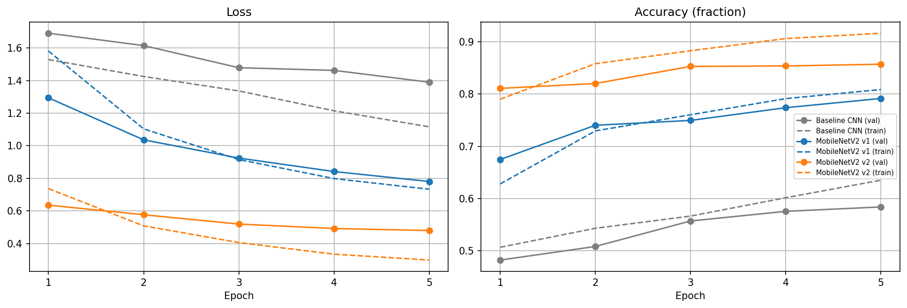
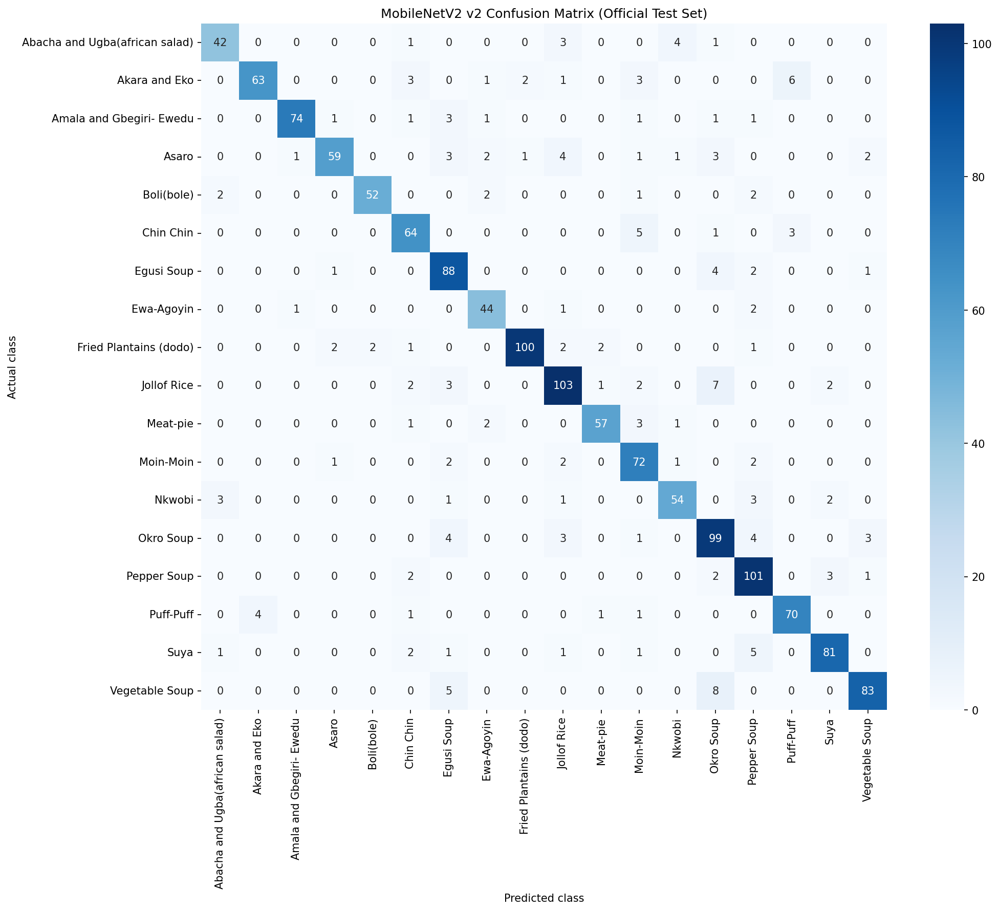

# Nigerian Food Image Classifier

An image classifier for **18 Nigerian dishes and snacks** (jollof rice, egusi soup, suya, puff-puff and more), built in PyTorch. The project compares a CNN trained from scratch against ImageNet transfer learning with MobileNetV2, then fine-tunes the best model and examines where and why it still fails.

**Final model (v2): 87.53% accuracy on the official test set (1,492 images), 87.44% after excluding test images that also appear in the training data.**

Built by Musa Ahmed as a portfolio project for an AI engineering course. Trained on a Kaggle Tesla T4 GPU with PyTorch 2.11.0 and torchvision 0.26.0.

---

## Results

| Model | Val, all 1,190 images | Val, 1,051 unique images | Test, 1,492 images |
|---|---|---|---|
| Baseline CNN (from scratch, 5 epochs) | 58.40% | 55.09% | not evaluated |
| MobileNetV2, frozen backbone (v1) | 79.16% | 77.93% | not evaluated |
| MobileNetV2, last two blocks fine-tuned (v2) | **85.71%** | **84.59%** | **87.53%** (87.44% excluding 19 duplicates) |

"Unique" means the validation image has no byte-identical copy in the training split (see [Data quality check](#data-quality-check)). It is the more conservative estimate.

**How to read these numbers**

- Model v2 was selected using the validation set only. The official test set was used once, after all modelling decisions were made, and nothing was changed afterwards.
- With 1,492 test images, sampling noise alone is roughly ±1.7 percentage points (95% range). The test score being slightly higher than the validation score is within that noise and should not be read as the model being better than validation suggested.
- Baseline and v1 were not run on the test set. Their validation numbers are the only comparison available for them.
- Every result comes from a single training run. No multiple-seed variance was measured.

### Learning curves



Fine-tuning (v2) started from the v1 weights, so its epoch 1 follows v1's epoch 5 and is not directly comparable with the other curves' epoch 1. At epoch 5 the v2 train/validation accuracy gap was about 5.9 points (91.65% vs 85.71%), up from about 1.7 for v1. Validation loss was still falling, but more slowly each epoch.

### Test-set confusion matrix (v2)



The validation confusion matrix is in `Images/confusion_matrix_val_v2.png`, and the full per-class test report is in `reports/test_classification_report.txt`.

### Per-class test results (v2)

Test macro F1 is 0.877.

| | Class | F1 | Notes |
|---|---|---|---|
| Strongest | Fried Plantains (dodo) | 0.939 | |
| | Amala and Gbegiri-Ewedu | 0.931 | |
| | Boli (bole) | 0.920 | |
| Weakest | Okro Soup | 0.825 | lowest precision (0.786): other foods get labelled Okro |
| | Asaro | 0.837 | lowest recall (0.766) with high precision (0.922): misses about a quarter of real Asaro |
| | Moin-Moin | 0.842 | |

---

## Dataset

[Nigerian Foods and Snacks Multiclass Classification](https://www.kaggle.com/datasets/peaceedogun/nigerian-foods-and-snacks-multiclass) on Kaggle (the `data_train_test` variant). Please check the dataset page for its license and terms. **The dataset is not included in this repository.**

- 18 classes, with a train folder (5,947 images) and a test folder (1,492 images).
- The training folder was split 80/20 into **4,757 train / 1,190 validation** images, stratified by class, with `random_state=42`.
- The official test folder was never used for training, tuning or model selection.
- `models/split_manifest.json` stores the exact train/validation split (file paths and labels), so the split can be reproduced regardless of file listing order. The paths inside it are the original Kaggle paths.

The 18 classes: Abacha and Ugba (African salad), Akara and Eko, Amala and Gbegiri-Ewedu, Asaro, Boli (bole), Chin Chin, Egusi Soup, Ewa-Agoyin, Fried Plantains (dodo), Jollof Rice, Meat-pie, Moin-Moin, Nkwobi, Okro Soup, Pepper Soup, Puff-Puff, Suya, Vegetable Soup.

---

## Method

| | Baseline CNN | MobileNetV2 v1 | MobileNetV2 v2 |
|---|---|---|---|
| Architecture | 3 conv blocks (32, 64, 128 channels), ReLU, max pooling, FC layer of 256, dropout 0.4 | ImageNet-pretrained MobileNetV2, new 18-class linear head | Starts from v1 |
| Trainable parameters | 8,486,738 (all) | 23,058 of 2,246,930 (1.0%) | 909,138 of 2,246,930 (40.5%) |
| Frozen | nothing | whole backbone | feature blocks 0 to 16 |
| Input | 128 × 128, no normalization | 224 × 224, ImageNet normalization | 224 × 224, ImageNet normalization |
| Optimizer | Adam, lr 1e-3 | Adam, lr 1e-3 (head only) | Adam, lr 1e-4 (blocks 17 and 18), 5e-4 (head) |
| Epochs | 5 | 5 | 5 (best epoch by validation accuracy) |

Common to all models: cross-entropy loss, batch size 32, training augmentation of random horizontal flip and random rotation (±10°); validation and test images are only resized (and normalized for MobileNetV2).

**BatchNorm handling.** `requires_grad=False` does not stop BatchNorm layers from updating their running statistics in train mode. For frozen blocks, the notebook keeps them in `eval()` mode during training so the pretrained statistics do not drift. In v2, blocks 17 and 18 stay in train mode so their BatchNorm layers adapt together with their weights.

**Why a small learning rate for fine-tuning.** The unfrozen blocks hold pretrained features, and large updates can overwrite them (catastrophic forgetting). The new head started from random weights in v1 and tolerates a somewhat larger rate.

---

## Error analysis

The validation confusion matrix for v1 showed that most errors fall between look-alike dishes:

- **Soups:** Okro Soup mistaken for Pepper Soup (11 errors, the largest single confusion), Vegetable Soup mistaken for Okro Soup (8), and Egusi Soup mistaken for Vegetable Soup (6).
- **Snacks:** Meat-pie mistaken for Moin-Moin (6), and Moin-Moin mistaken for Jollof Rice (6).
- **Asaro (yam porridge):** low recall, with misses spread across several classes, most often Fried Plantains and Jollof Rice. Both Asaro and fried plantains are orange-yellow chunks.

I inspected 31 of these error images by eye (11 Okro to Pepper, 8 Vegetable to Okro, 12 missed Asaro). This is a small, qualitative sample and not a measurement.

- Many of the soup errors were visually ambiguous or poor-quality photos (cropped, watermarked, or dishes where okra is simply one ingredient).
- Most of the missed Asaro images were recognizable yam porridge, so those errors look more like feature limitations than label problems.

Effect of fine-tuning on validation (v1 to v2):

- v2 fixed **101 of v1's 248 errors (41%)** and broke 23 of v1's 942 correct predictions (net change −78 errors).
- Of the 11 Okro-to-Pepper errors, v2 fixed 7. Of the 23 missed Asaro images, v2 fixed 10. These counts are small, and the Okro rate (64%) sits above the 41% average while Asaro (43%) is average.
- Validation accuracy on images the model had not seen copies of (the unique subset) improved by about 6.7 points from v1 to v2, so the gain does not appear to be caused by memorizing duplicates.

---

## Data quality check

I ran an exact-duplicate check (MD5 hash of file bytes):

| Finding | Count |
|---|---|
| Validation images byte-identical to a training image | 139 of 1,190 (11.7%) |
| Test images byte-identical to a training image | 19 of 1,492 (1.3%) |
| Redundant files inside the training split | 311 of 4,757 (6.5%) |
| Validation images whose training copy carries a different label | 2 |

Effect on accuracy (validation, duplicates vs unique images):

| Model | On duplicates | On unique images | Overall |
|---|---|---|---|
| Baseline CNN | 83.45% | 55.09% | 58.40% |
| MobileNetV2 v1 | 88.49% | 77.93% | 79.16% |
| MobileNetV2 v2 | 94.24% | 84.59% | 85.71% |

On the test set, v2 classified 18 of the 19 duplicate images correctly; excluding them changes accuracy from 87.53% to 87.44%.

The check only finds byte-identical files. Resized or re-compressed copies are not detected, so the "unique" figures may still be slightly optimistic. I did not retrain on a de-duplicated split.

---

## Limitations

1. **Closed-set classifier.** The model only knows 18 dishes, while Nigerian cuisine has hundreds. It always returns one of the 18 labels, even for an unfamiliar dish or a non-food image, and its confidence score should not be trusted for dishes outside these classes.
2. **Web photos, not phone photos.** Most training and test images look like web, stock or recipe-blog photos. Performance on casual phone photos, different lighting or mixed plates is untested and is likely lower. The test set comes from the same source as the training data, so it cannot measure this gap.
3. **Label ambiguity and image quality.** Some images are ambiguous, poorly cropped or arguably mislabeled, especially among the soups. This limits achievable accuracy and was not cleaned.
4. **Duplicates.** See [Data quality check](#data-quality-check). Duplicates were found and reported, not removed.
5. **Slightly optimistic validation numbers.** The fine-tuning epoch and learning rates were chosen using the validation set.
6. **Single run.** No repeated runs or confidence intervals from multiple seeds.
7. **Incomplete comparison on the test set.** Baseline and v1 were not evaluated on the test set.
8. **Not analyzed:** whether the redundant training copies bias the model toward particular classes, and per-class calibration of the confidence scores.

### Intended use

Learning and demonstration. It is not intended for allergen decisions, dietary or medical advice, or any decision where a wrong dish label could cause harm.

---

## Repository structure

```
nigerian-food-classifier/
├── README.md
├── requirements.txt
├── notebooks/
│   └── nigerian_food_classifier.ipynb
├── models/
│   ├── mobilenetv2_nigerian_food_v1.pth
│   ├── mobilenetv2_nigerian_food_v2.pth
│   ├── class_to_idx.json
│   └── split_manifest.json
├── images/
│   ├── learning_curves.png
│   ├── confusion_matrix_val_v2.png
│   └── confusion_matrix_test.png
└── reports/
    └── test_classification_report.txt
```

The `.pth` files are PyTorch `state_dict` files. They contain only weights and biases, so they must be used together with `class_to_idx.json` (which output number means which dish) and the same preprocessing described above.

---

## Using the model

```python
import json
import torch
import torch.nn as nn
from torchvision import models, transforms
from PIL import Image

with open("models/class_to_idx.json") as f:
    class_to_idx = json.load(f)
idx_to_class = {i: name for name, i in class_to_idx.items()}

model = models.mobilenet_v2(weights=None)
model.classifier[1] = nn.Linear(1280, 18)
model.load_state_dict(torch.load("models/mobilenetv2_nigerian_food_v2.pth", map_location="cpu"))
model.eval()

preprocess = transforms.Compose([
    transforms.Resize((224, 224)),
    transforms.ToTensor(),
    transforms.Normalize([0.485, 0.456, 0.406], [0.229, 0.224, 0.225]),
])

img = preprocess(Image.open("my_photo.jpg").convert("RGB")).unsqueeze(0)
with torch.no_grad():
    probs = torch.softmax(model(img), dim=1)[0]

for p, i in zip(*probs.topk(3)):
    print(f"{idx_to_class[i.item()]}: {p.item():.1%}")
```

Skipping the resize and normalization steps will silently reduce accuracy.

---

## Reproducing the results

1. Open `notebooks/nigerian_food_classifier.ipynb` in Kaggle (or another environment with a GPU).
2. Add the Kaggle dataset linked above.
3. Upload the files in `models/` as a Kaggle dataset of your own, then edit the path constants (`V1_PATH`, `V2_PATH`, `BASELINE_CKPT`, `MANIFEST`) in the notebook so they point to your copies. The paths currently in the notebook belong to my Kaggle account.
4. Keep `RETRAIN = False` and run all cells. The notebook loads the saved weights and reproduces the reported evaluation numbers, with check cells that print the expected values (79.16% for v1 and 85.71% for v2 on validation).

Notes on reproducibility:

- The baseline checkpoint was produced in an earlier session and is not included in this repository, so the baseline is loaded from a Kaggle dataset I own. Its training history comes from that checkpoint.
- The v1 and v2 training histories shown in the notebook were transcribed from the printed output of the original training runs, not recomputed.
- The `RETRAIN = True` branches contain the training code but have **not been executed in the final notebook**. Retraining is unlikely to reproduce the exact numbers, because GPU training is not fully deterministic and the original runs did not fix a seed. The check cells will therefore not match after retraining.
- The original training was done in an earlier, messier notebook. The final notebook was rebuilt from it and verified by confirming it reproduces every reported number from the saved weights.

## Environment

Python with PyTorch 2.11.0 and torchvision 0.26.0 (CUDA, Tesla T4). Other dependencies are listed in `requirements.txt`.

